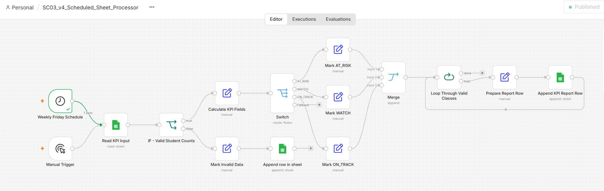

# SC03 — Scheduled KPI Report

An n8n workflow that reads fictional class-completion data from Google Sheets, validates each record, classifies completion performance, records invalid data separately, and produces a scheduled KPI report.

## Business Problem

A training coordinator needs a reliable weekly report showing class completion performance. Manual processing is slow, invalid student counts may enter the report, and classes requiring follow-up are difficult to identify consistently.

## Solution

The workflow:

1. Runs manually for testing or automatically every Friday at 08:00 (Asia/Ho_Chi_Minh).
2. Reads class records from the `KPI_Input` sheet.
3. Validates assigned and completed student counts.
4. Excludes invalid records from KPI calculations.
5. Calculates completion metrics.
6. Classifies valid classes as `AT_RISK`, `WATCH`, or `ON_TRACK`.
7. Writes valid results to `KPI_Report`.
8. Writes invalid records to `Invalid_Records`.

## Workflow Overview

## Business Rules

- `assigned_students` must be greater than zero.
- `completed_students` must be between zero and `assigned_students`.
- Completion rate below 80 is `AT_RISK`.
- Completion rate from 80 to below 90 is `WATCH`.
- Completion rate of 90 or above is `ON_TRACK`.
- Invalid records are excluded from KPI calculations.

## Test Results

| Test | Result |
|---|---|
| Read four input rows | PASS |
| Write three valid KPI rows | PASS |
| Route CLS-004 to invalid records | PASS |
| Classify 60, 80 and 95 correctly | PASS |
| Complete an automatic scheduled execution | PASS |

See the [full test log](docs/SC03_v4_Scheduled_Sheet_Processor_Test_Log.md).

## Evidence

- [Input sheet](evidence/v4/01_KPI_Input_Sheet.png)
- [Four input items](evidence/v4/02_Read_Four_Items.png)
- [Report and invalid results](evidence/v4/03_Report_and_Invalid_Results.png)
- [Schedule settings](evidence/v4/04_Schedule_Settings.png)
- [Scheduled execution](evidence/v4/05_Scheduled_Execution.png)
- [Final workflow](evidence/v4/06_Final_Workflow.png)

## Files

- [Public workflow JSON](workflows/SC03_v4_Scheduled_Sheet_Processor.json)
- [Sample input data](sample_data/KPI_Input_sample.csv)
- [Test log](docs/SC03_v4_Scheduled_Sheet_Processor_Test_Log.md)
- [N8N101 certificate](../../04_Certificates/N8N/01_N8N101_Certificate.pdf)

## Setup

1. Import the workflow JSON into n8n.
2. Create a Google Sheets OAuth2 credential.
3. Create `KPI_Input`, `KPI_Report`, and `Invalid_Records` sheets.
4. Copy the sample data into `KPI_Input`. Create the output headers using the field names shown in the output evidence.
5. In all three Google Sheets nodes, select your credential and replace the placeholder document URL with your spreadsheet URL.
6. Reselect the target sheet in each node: `KPI_Input`, `KPI_Report`, and `Invalid_Records`.
7. Set the workflow timezone to `Asia/Ho_Chi_Minh`.
8. Test manually before publishing the schedule.

## Security

- All student and class data is fictional.
- Credential values and access tokens are excluded.
- The public JSON uses placeholder connection identifiers.
- The working Google spreadsheet remains private.

## Known Limitations

- Repeated executions can append duplicate rows.
- Duplicate prevention is planned for the next version.
- KPI thresholds are fixed.
- Failure notifications are not yet implemented.

## Skills Demonstrated

- n8n workflow design
- Google Sheets integration
- OAuth2 credential use
- Data validation and conditional routing
- Multi-item processing
- Scheduled automation
- Workflow testing and documentation